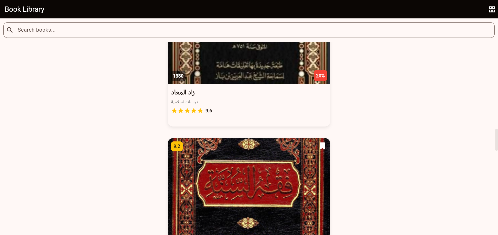
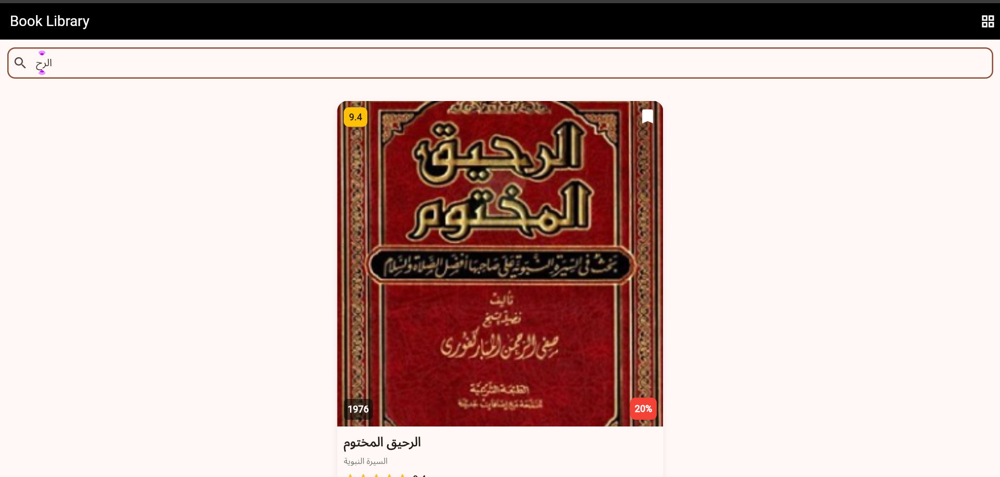
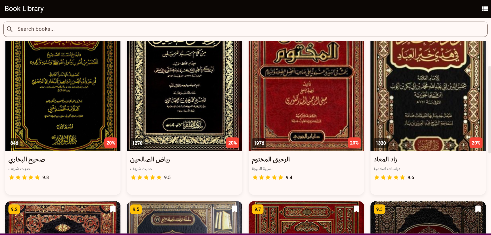
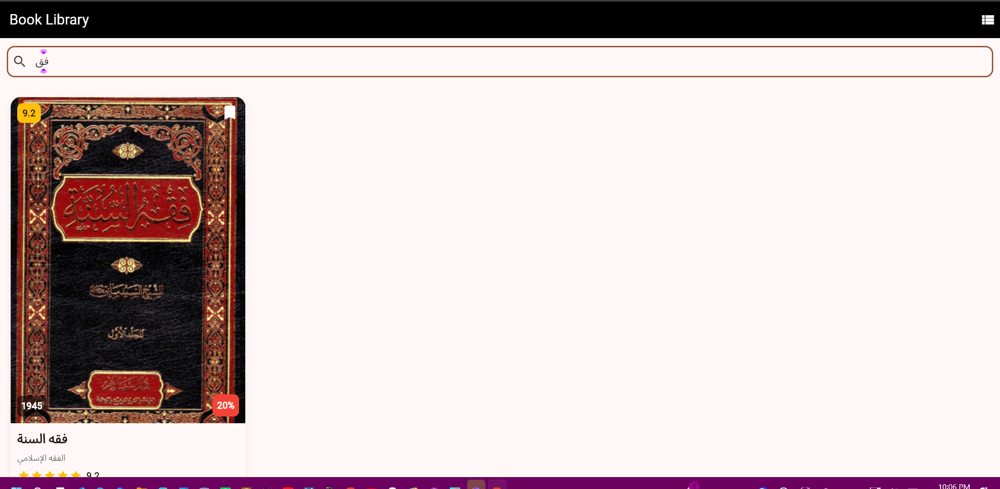

#  Islamic Library App

A beautiful, modern Flutter mobile application designed to showcase a curated collection of 8 authentic and classic Islamic books. The app offers a seamless user experience with dual layout viewing modes, instant search filtering, and custom-styled book cards.

---

##  Key Features

- **8 Authentic Islamic Books:** Features comprehensive metadata for major Islamic reference works:
  - *صحيح البخاري* (Sahih Al-Bukhari)
  - *رياض الصالحين* (Riyad as-Sal_ihin)
  - *الرحيق المختوم* (AL-Raheeq Al-Makhtum)
  - *زاد المعاد* (Zad al-Ma_ad)
  - *فقه السنة* (Fiqh as-Sunnah)
  - *الأربعون النووية* (Al-Arba'in an-Nawawiyyah)
  - *تفسير ابن كثير* (Tafsir Ibn Kathi_r)
  - *الداء والدواء* (Ad-Da' wa Ad-Dawa')

- **Dual Viewing Modes (List & Grid):** 
  - Smooth toggle between **ListView** and **GridView** (2 columns) using an `IconButton` in the `AppBar`.
  - State is managed reactively via `setState()`.

- **Live Search Filtering:**
  - Fast, case-insensitive search bar filtering books by both **Title** and **Genre**.
  - Implemented cleanly using `TextField.onChanged` without requiring a `TextEditingController`.

- **Custom Styled Book Cards:**
  - Built with a sleek `Container` and `BoxShadow` design.
  - Multi-layered layout using `Stack` and `Positioned` widgets for top-left ratings, top-right bookmark icons, and publication years.

- **Synchronized Interactive Badge (Bonus):**
  - Features an interactive discount/reading badge on every card that stays synchronized across all views when tapped using callback triggers.

---

##  UI Theme

Designed with a rich Islamic Emerald Green palette (`#1B5E20`) that dynamically applies across all widgets using Material 3 `Theme.of(context)`.

---

##  Project Architecture

```text
lib/
    book.dart        # Book data model & 8 initialized book instances
    book_card.dart   # Reusable card widget with Stack/Positioned elements
    home_page.dart   # Main interface with search bar, list/grid toggle & state
    main.dart        # Entry point configuring the global Material app theme
```
assets/
    covers/
       40_hadith.png
       al_daa_wa_al_dawa.png
       bukhari.png
       fiqh.png
       ibn_kathi_r.png
       rah_ik.png
       riyadh.png
       zad.png
---

##  Setup & Installation

1. **Place Assets:** Ensure all book cover images are present in the `assets/covers/` directory:
   - `assets/covers/bukhari.png`
   - `assets/covers/riyadh.png`
   - `assets/covers/rah_ik.png`
   - `assets/covers/zad.png`
   - `assets/covers/fiqh.png`
   - `assets/covers/40_hadith.png`
   - `assets/covers/ibn_kathi_r.png`
   - `assets/covers/al_daa_wa_al_dawa.png`

2. **Configure `pubspec.yaml`:**
   ```yaml
   flutter:
     uses-material-design: true
     assets:
       - assets/covers/
   ```

3. **Get Dependencies & Run:**
   ```bash
   flutter pub get
   flutter run
   ```

---

## ️ Built With

* **Flutter** - Cross-platform UI toolkit
* **Dart** - Programming language
* **Material Design 3** - Modern UI components


## 📱 Screenshots

### List View



### Grid View


